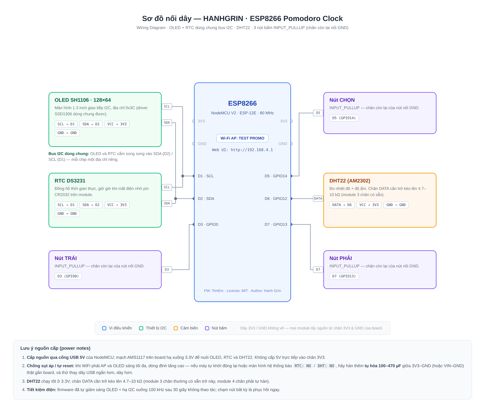

<div align="center">

# ⏰ HANHGRIN — ESP8266 Pomodoro Desk Clock

**A desk clock + Pomodoro timer + 6-game mini console on ESP8266 — small screen, big fun.**
**Đồng hồ để bàn + máy bấm giờ Pomodoro + máy chơi game mini trên ESP8266 — màn hình nhỏ, vui lớn.**


*Firmware codename: `TimEm` · Made with ♥ by **Hanh Grin***

</div>

---

## 📖 About / Giới thiệu

**EN** — HANHGRIN is a pocket-sized desk gadget built on an ESP8266 NodeMCU. It shows a beautiful 7-segment style clock backed by a DS3231 RTC (keeps time even without power), tracks room temperature & humidity with a DHT22, runs a full Pomodoro workflow with weekly statistics saved to EEPROM, guides your breathing with a 4-4 exercise, and — because work without play is boring — it also packs **6 retro games** including a complete Tetris. Everything is controlled with just **3 physical buttons**, or remotely from your phone through a built-in **Wi-Fi web dashboard** (the device broadcasts its own access point, no home Wi-Fi needed).

**VI** — HANHGRIN là một chiếc gadget để bàn bỏ túi chạy trên ESP8266 NodeMCU. Nó hiển thị đồng hồ kiểu 7 đoạn (số 7 đoạn) được hậu thuẫn bởi RTC DS3231 (không lo mất giờ khi cúp điện), đo nhiệt độ & độ ẩm phòng bằng DHT22, chạy đủ quy trình Pomodoro kèm thống kê tuần lưu trong EEPROM, hướng dẫn thở 4-4, và — vì làm việc mà không chơi thì buồn — máy còn có sẵn **6 trò chơi retro**, trong đó có Tetris hoàn chỉnh. Mọi thứ điều khiển được bằng đúng **3 nút bấm**, hoặc điều khiển từ xa qua điện thoại bằng **web dashboard Wi-Fi** tích hợp sẵn (máy tự phát access point riêng, không cần Wi-Fi nhà).

## ✨ Features / Tính năng

| | Feature / Tính năng |
|---|---|
| 🕐 | **Clock** — 7-segment drawing, date + weekday, blinking colon / **Đồng hồ** vẽ 7 đoạn, ngày tháng + thứ, dấu hai chấm nhấp nháy |
| 🌡️ | **Room monitor** — DHT22 temperature & humidity, min/max, 24-sample sparkline, comfort verdict / **Theo dõi phòng** — nhiệt độ, độ ẩm, min/max, biểu đồ 24 cột, đánh giá cảm giác |
| 🍅 | **Pomodoro** — configurable focus (5–90 min) & break (1–30 min), cycle counter, weekly bar chart, motivational quotes / **Pomodoro** — tùy chỉnh phút tập trung & nghỉ, đếm chu kỳ, biểu đồ tuần, quote động viên |
| ⏱️ | **Quick timer** — 1–60 min countdown / **Hẹn giờ nhanh** — đếm ngược 1–60 phút |
| 🫁 | **Breathing 4-4** — animated circle, inhale/exhale pacing / **Thở 4-4** — hình tròn phồng/xẹp theo nhịp hít–thở |
| 🎮 | **6 games** — SHOOT, NYAN cat runner, full **TETRIS** (rotate, hard drop, scoring, speed-up), FLAPPY, virtual CAT pet, SNAKE / **6 trò chơi** — Bắn, Nyan, **Tetris đầy đủ** (xoay, hạ nhanh, tính điểm, tăng tốc), Bay, mèo ảo, Rắn |
| 📶 | **Wi-Fi dashboard** — captive portal at `192.168.4.1`, control everything from your phone / **Web dashboard** — captive portal tại `192.168.4.1`, điều khiển mọi thứ từ điện thoại |
| 🔄 | **Screen rotation** — 4 orientations (0°/90°/180°/270°), software 90° pixel rotation written from scratch / **Xoay màn hình** — 4 hướng, tự viết thuật toán xoay pixel 90° |
| 🌙 | **Auto night dim** + **power save** (30 s idle → dim OLED, I2C 100 kHz) / **Tự tối ban đêm** + **tiết kiệm điện** |
| 💾 | **EEPROM persistence** — settings & stats survive power loss / **Lưu EEPROM** — cài đặt & thống kê không mất khi cúp điện |
| 🥚 | Boot animation with a secret message after 3 s / Màn hình boot có dòng chữ bí mật sau 3 giây 💘 |

## 🧰 Hardware / Phần cứng (BOM)

| Part / Linh kiện | Qty / SL | Notes / Ghi chú |
|---|---|---|
| ESP8266 NodeMCU V2 (ESP-12E) | 1 | Main board |
| OLED SH1106 1.3″ 128×64 I2C | 1 | Address `0x3C`; SSD1306 module also works / module SSD1306 cũng dùng được |
| RTC DS3231 module | 1 | + CR2032 battery / kèm pin CR2032 |
| DHT22 (AM2302) | 1 | Temp ±0.5 °C / nhiệt độ ±0.5 °C |
| Tactile button 6×6 mm | 3 | LEFT / SELECT / RIGHT |
| Capacitor 100–470 µF *(optional)* | 1–2 | Power stability — see Power notes / chống sụt áp — xem lưu ý nguồn |
| Micro-USB cable + 5 V adapter | 1 | At least 1 A recommended / nên dùng adapter ≥ 1 A |

## 🔌 Wiring / Sơ đồ nối dây

| Module | Pin | → NodeMCU |
|---|---|---|
| OLED SH1106 | SCL / SDA / VCC / GND | **D1** / **D2** / 3V3 / GND |
| RTC DS3231 | SCL / SDA / VCC / GND | **D1** / **D2** *(shared I2C bus)* / 3V3 / GND |
| DHT22 | DATA / VCC / GND | **D6** (GPIO12) / 3V3 / GND |
| Button LEFT | leg 1 / leg 2 | **D3** (GPIO0) / GND |
| Button SELECT | leg 1 / leg 2 | **D5** (GPIO14) / GND |
| Button RIGHT | leg 1 / leg 2 | **D7** (GPIO13) / GND |



> Buttons use `INPUT_PULLUP` — no external resistors needed. / Nút bấm dùng `INPUT_PULLUP` — không cần trở ngoài.

## 🚀 Getting Started / Bắt đầu

This is a **standard PlatformIO project** — the repo layout follows the PlatformIO convention, so VS Code picks it up automatically. / Đây là **project PlatformIO chuẩn** — cấu trúc repo đúng chuẩn PlatformIO, VS Code nhận tự động.

1. Install **[Visual Studio Code](https://code.visualstudio.com/)** and the **[PlatformIO IDE extension](https://platformio.org/platformio-ide)**. / Cài VS Code và extension PlatformIO IDE.
2. Clone or download this repo, then **File → Open Folder…** / Mở project bằng **File → Open Folder…**
3. PlatformIO auto-installs the toolchain and all libraries from `platformio.ini` (first build takes a few minutes). / PlatformIO tự tải toolchain + toàn bộ thư viện khai báo trong `platformio.ini` (lần build đầu hơi lâu).
4. Plug in the NodeMCU, then click **→ (Upload)** on the bottom toolbar. / Cắm NodeMCU, nhấn nút **→ (Upload)** trên thanh công cụ dưới cùng.
5. Open the Serial Monitor (plug 🔌 icon, `115200 baud`) to watch the boot log. / Mở Serial Monitor (icon 🔌, baud `115200`) để xem log boot.

## 🎮 Button controls / Điều khiển bằng nút

| Screen / Màn hình | LEFT (D3) | SELECT (D5) | RIGHT (D7) |
|---|---|---|---|
| Main menu / Menu chính | Previous / Lùi | Open / Mở | Next / Tiến |
| Pomodoro | Back / Về menu | Start ⏸ Pause | Reset |
| Quick timer / Hẹn giờ | Back / Về menu | Start ⏸ Stop | Change minutes / Đổi số phút |
| Stats / Thống kê | Back / Về menu | **Long-press = clear all** / **Giữ dài = xóa hết** | — |
| Settings / Cài đặt | Back / Về menu | Short = +1 · Long = −1 | Next item / Mục kế |
| Games menu | Previous / Lùi | Short = play · Long = exit | Next / Tiến |
| SHOOT | Move left / Trái | Short = fire · Long = exit | Move right / Phải |
| TETRIS | Move left / Trái | Short = rotate · Long = **hard drop** | Move right / Phải |
| FLAPPY | Long = exit | **Hold to flap** / **Giữ để bay** | — |
| CAT | Feed / Cho ăn | Long = exit | Pet / Vuốt |
| SNAKE | Turn left / Quẹt trái | Long = exit | Turn right / Quẹt phải |

> **Secret combo:** hold **LEFT + RIGHT** anywhere in games → exit to menu. / **Phím tắt:** giữ **TRÁI + PHẢI** trong game để thoát ra menu.

## 🌐 Web dashboard / Bảng điều khiển web

1. On your phone, connect to Wi-Fi **`TEST PROMO`** (password / mật khẩu: **`111222333`**).
2. Open / Mở **http://192.168.4.1** — any domain also redirects there automatically (captive portal). / mọi tên miền cũng tự chuyển về đây.
3. Full control: / Điều khiển toàn bộ:
   - Live clock, temperature, humidity, free RAM / Đồng hồ, nhiệt độ, độ ẩm, RAM trống
   - **Sync RTC from phone time** with one tap / **Đồng bộ giờ RTC từ điện thoại** chỉ một nút
   - Start/stop/reset Pomodoro & quick timer / Chạy–dừng–reset Pomodoro và hẹn giờ
   - Switch screens, launch any game, toggle the Nyan cat / Chuyển màn hình, mở game bất kỳ, bật mèo Nyan
   - Screen rotation, auto night dim, focus/break sliders / Xoay màn hình, tự tối đêm, thanh trượt phút tập trung/nghỉ
   - Live hardware-button indicator + total press count / Đèn báo nút bấm thật + tổng số lần bấm

> **Change the Wi-Fi name/password:** edit these two lines at the top of [`src/main.cpp`](src/main.cpp) and re-upload. / **Đổi tên/mật khẩu Wi-Fi:** sửa 2 dòng này ở đầu [`src/main.cpp`](src/main.cpp) rồi nạp lại:
>
> ```cpp
> #define AP_SSID "TEST PROMO"
> #define AP_PASS "111222333"
> ```

## 🔋 Power notes / Lưu ý nguồn cấp

- Power everything from the NodeMCU **USB port (5 V)**; the onboard AMS1117 makes 3.3 V. Never feed 5 V into the 3V3 pin. / Cấp nguồn qua **cổng USB (5 V)** của NodeMCU; AMS1117 trên board tạo 3.3V. Không bao giờ cấp 5V vào chân 3V3.
- Wi-Fi AP + full-brightness OLED can cause voltage sags. If the device **randomly reboots** or System screen shows `RTC: NO` / `DHT: NO`, add a **100–470 µF electrolytic capacitor** between 3V3–GND (or VIN–GND) close to the board, and try a shorter/thicker USB cable. / Wi-Fi phát AP + OLED sáng tối đa dễ gây sụt áp. Nếu máy **tự reset** hoặc màn Hệ thống báo `RTC: NO` / `DHT: NO`, hàn thêm **tụ hóa 100–470 µF** giữa 3V3–GND (hoặc VIN–GND) gần board, và thử dây USB ngắn/dày hơn.
- DHT22 works fine at 3.3 V; DATA needs a 4.7–10 kΩ pull-up (3-pin modules already include it). / DHT22 chạy tốt ở 3.3V; chân DATA cần trở kéo 4.7–10 kΩ (module 3 chân có sẵn).
- Firmware already throttles itself: 30 s idle → OLED dim + I2C at 100 kHz; any button press wakes it instantly. / Firmware đã tự tiết kiệm: 30 giây không bấm → giảm sáng OLED + I2C 100 kHz; bấm nút bất kỳ là tỉnh ngay.

## ⚙️ Defaults & storage / Cài đặt mặc định & lưu trữ

| Setting / Tham số | Default / Mặc định |
|---|---|
| Focus / Tập trung | 25 min |
| Break / Nghỉ | 5 min |
| Dim hour / Giờ tối | 22:00 (auto-dim ON) |
| Rotation / Hướng màn hình | 1 — landscape flipped / ngang lật 180° |
| EEPROM magic | `0xC501` |

Settings + weekly stats live in EEPROM (`EEPROM.put/get`) — they survive reboots and power loss. To factory-reset, erase flash then change any setting once. / Cài đặt + thống kê tuần nằm trong EEPROM — không mất khi khởi động lại. Muốn reset nhà máy, xóa flash rồi đặt lại cài đặt.

## 📁 Project structure / Cấu trúc project

```
esp8266-pomodoro-clock/
├── platformio.ini        # PlatformIO build config / cấu hình build
├── src/
│   └── main.cpp          # All firmware source (~1,800 lines, single file) / toàn bộ mã nguồn
├── include/              # (empty, PlatformIO convention) / (trống, theo chuẩn PlatformIO)
├── lib/                  # (empty, PlatformIO convention)
├── test/                 # (empty, PlatformIO convention)
├── docs/
│   └── wiring.png        # Wiring diagram / sơ đồ nối dây
├── GITHUB_GUIDE.md       # How to push this to GitHub / hướng dẫn đẩy lên GitHub
├── LICENSE               # MIT
└── README.md
```

## 📜 License / Giấy phép

Released under the **MIT License** — see [LICENSE](LICENSE). Built with love by **Hanh Grin**. / Phát hành theo giấy phép **MIT** — xem [LICENSE](LICENSE). Được làm bằng cả trái tim bởi **Hanh Grin** 💚

---

---

# 🇻🇳 Bản tiếng Việt (toàn bộ nội dung)

<div align="center">

## ⏰ HANHGRIN — Đồng hồ Pomodoro để bàn ESP8266

**Đồng hồ để bàn + Pomodoro + 6 trò chơi mini trên ESP8266 — do Hanh Grin làm với cả trái tim 💚**

</div>

### 📖 Đây là cái gì?

HANHGRIN là một chiếc đồng hồ để bàn "lai" máy game tự làm trên ESP8266 NodeMCU:

- **Đồng hồ 7 đoạn** vẽ tay bằng code, có ngày tháng + thứ, giờ lưu trong RTC DS3231 nên **cúp điện cũng không mất giờ** (nhờ pin CR2032).
- **Theo dõi phòng:** DHT22 đo nhiệt độ/độ ẩm, nhớ min/max, vẽ biểu đồ 24 cột, kèm đánh giá "LẠNH / DỄ CHỊU / HƠI NÓNG / NÓNG".
- **Pomodoro đầy đủ:** tùy chỉnh phút tập trung (5–90) và nghỉ (1–30), đếm số chu kỳ, **biểu đồ cột thống kê 7 ngày trong tuần**, xong một phiên hiện quote động viên kiểu *"UỐNG NƯỚC ĐI BẠN"* 😄
- **Hẹn giờ nhanh** 1–60 phút, **thở 4-4** có hình tròn phồng–xẹp theo nhịp.
- **6 game:** SHOOT (bắn phi thuyền), NYAN (mèo cầu vồng), **TETRIS hoàn chỉnh** (xoay, hard drop, tính điểm 100/300/600/1000, tăng tốc theo số dòng), FLAPPY, mèo ảo cần được cho ăn & vuốt ve, SNAKE.
- **Web dashboard Wi-Fi:** máy tự phát access point, điện thoại nối vào là điều khiển được tất cả — kể cả **đồng bộ giờ từ điện thoại**.

### 🔌 Nối dây

| Module | Chân module | → NodeMCU |
|---|---|---|
| OLED SH1106 | SCL / SDA / VCC / GND | **D1** / **D2** / 3V3 / GND |
| RTC DS3231 | SCL / SDA / VCC / GND | **D1** / **D2** *(chung bus I2C với OLED)* / 3V3 / GND |
| DHT22 | DATA / VCC / GND | **D6** / 3V3 / GND |
| Nút TRÁI | 2 chân | **D3** (GPIO0) / GND |
| Nút CHỌN | 2 chân | **D5** (GPIO14) / GND |
| Nút PHẢI | 2 chân | **D7** (GPIO13) / GND |

Xem sơ đồ trực quan: **[docs/wiring.png](docs/wiring.png)** — nút bấm dùng `INPUT_PULLUP` nên không cần trở ngoài.

### 🚀 Cách nạp code (VS Code + PlatformIO)

1. Cài **Visual Studio Code** + extension **PlatformIO IDE**.
2. Tải repo này về, mở bằng **File → Open Folder…** — cấu trúc đã đúng chuẩn PlatformIO nên VS Code nhận ngay.
3. Đợi PlatformIO tự tải thư viện (khai báo sẵn trong `platformio.ini`).
4. Cắm NodeMCU → nhấn **→ (Upload)**.
5. Mở Serial Monitor (`115200`) xem log boot: `=== BOOT TimEm ===`.

### 🎮 Điều khiển bằng 3 nút

- **Menu chính:** TRÁI/PHẢI di chuyển, CHỌN để mở. Có 9 mục: ĐỒNG HỒ, PHÒNG, POMO, HẸN GIỜ, STATS, CÀI ĐẶT, HỆ THỐNG, THỞ 4-4, GAMES.
- **Pomodoro:** CHỌN = chạy/tạm dừng, PHẢI = đặt lại.
- **Hẹn giờ:** CHỌN = chạy/dừng, PHẢI = đổi số phút (5→10→15→20→25→30).
- **Cài đặt:** PHẢI = chọn mục, CHỌN nhấn ngắn = +1, giữ dài = −1.
- **Trong game:** giữ **TRÁI + PHẢI** để thoát; Tetris: CHỌN nhấn ngắn = xoay, giữ dài = **hạ khối nhanh**.
- Chi tiết từng game xem bảng ở phần tiếng Anh phía trên.

### 🌐 Dùng qua điện thoại

1. Nối Wi-Fi **`TEST PROMO`**, mật khẩu **`111222333`**.
2. Mở **http://192.168.4.1** (hoặc mở bất kỳ trang nào — máy tự chuyển về).
3. Từ web bạn làm được: đồng bộ giờ RTC từ điện thoại, chạy/dừng Pomodoro & hẹn giờ, mở game, xoay màn hình 4 hướng, bật/tắt tự tối ban đêm, chỉnh phút tập trung/nghỉ, xóa thống kê, xem nút bấm thật nhấp sáng.

> **Đổi tên & mật khẩu Wi-Fi:** sửa 2 dòng `AP_SSID` / `AP_PASS` ở đầu `src/main.cpp` rồi nạp lại. Mật khẩu tối thiểu 8 ký tự, tên AP nên tránh dấu tiếng Việt.

### 🔋 Lưu ý nguồn (quan trọng!)

- Cấp nguồn qua **USB 5V**; AMS1117 trên board tạo 3.3V. **Không cấp 5V vào chân 3V3.**
- WiFi phát AP + OLED sáng tối → dễ sụt áp. Nếu máy **tự reset** hoặc hệ thống báo `RTC: NO` / `DHT: NO`: hàn thêm **tụ hóa 100–470 µF** giữa 3V3–GND gần board, thay dây USB ngắn/dày hơn, dùng adapter ≥ 1A.
- DHT22 cần trở pull-up 4.7–10 kΩ trên DATA (module 3 chân có sẵn, module 4 chân phải tự hàn).
- Firmware có sẵn tiết kiệm điện: 30 giây không bấm → giảm sáng + hạ I2C về 100 kHz.

### 💾 Dữ liệu lưu ở đâu?

Toàn bộ cài đặt + thống kê tuần lưu trong **EEPROM** (khóa `0xC501`), mất điện không mất dữ liệu. Mặc định: tập trung 25 phút, nghỉ 5 phút, tự tối từ 22h, màn ngang lật 180°.

### 📜 Giấy phép

**MIT** — ai cũng dùng/sửa/chia sẻ được, chỉ cần giữ dòng bản quyền. Làm với cả trái tim bởi **Hanh Grin** 💚
